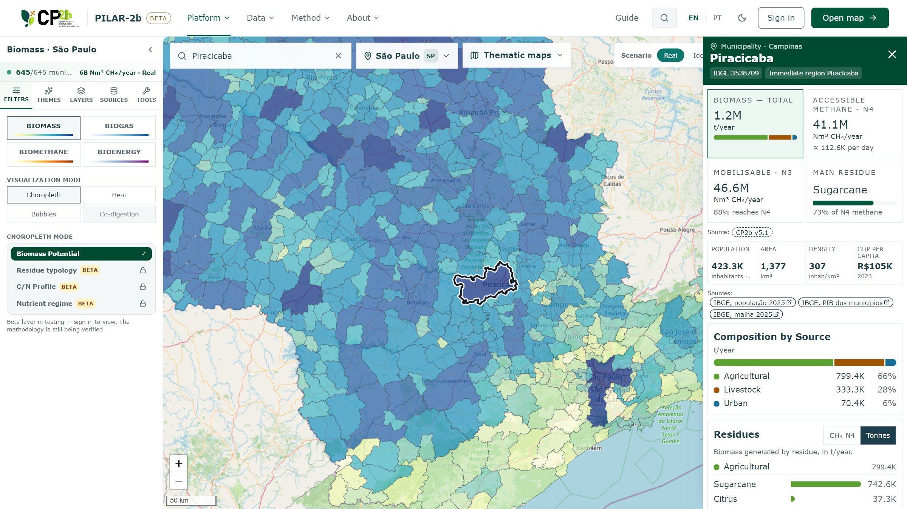
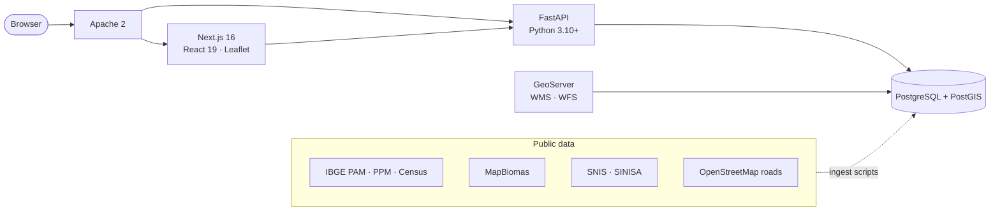

<h1 align="center">PILAR-2b</h1>

<p align="center">
  <strong>Open web GIS for mapping the biogas potential of agricultural, livestock and urban residues in Brazil</strong><br>
  <em>Plataforma Inteligente de Localização e Aproveitamento de Resíduos para Biogás e Bioprodutos</em>
</p>

<p align="center">
  <a href="https://cp2b.unicamp.br/pilar2b/en"></a>
  <a href="https://github.com/aikiesan/Pilar-2b/releases/latest"></a>
  <a href="./LICENSE"></a>
  <a href="https://github.com/aikiesan/Pilar-2b/actions/workflows/ci.yml"></a>
  <a href="https://doi.org/10.25824/REDU/F36WP9"></a>
  <a href="https://www.gov.br/inpi"></a>
</p>

<p align="center">
  <a href="https://cp2b.unicamp.br/pilar2b/en"></a>
</p>

PILAR-2b maps how much methane can be obtained from the residues of farming, livestock and
cities, municipality by municipality. It joins public datasets (IBGE, MapBiomas, SNIS/SINISA,
OpenStreetMap) in a PostGIS database and serves them through a browser interface, so planners,
researchers and investors can explore the potential without desktop GIS software.

It is developed at [NIPE-UNICAMP](https://nipe.unicamp.br/cp2b) by the São Paulo Centre for
Biogas and Bioproducts Studies (CP2b), and is live at
**[cp2b.unicamp.br/pilar2b](https://cp2b.unicamp.br/pilar2b/en)** in English and Portuguese.

## What it does

- **Municipal map** of the 645 municipalities of São Paulo State, plus a **beta pilot for
  Minas Gerais**, with search, a highlighted result and boundaries aligned along shared borders.
- **Potential in four levels**, from theoretical to accessible, per municipality, substrate and
  scenario. The method is described in a paper under review; the platform shows each value
  with its sources.
- **Municipality profile** with the main residues, a comparison with neighbours and the
  infrastructure nearby (gas pipelines, substations, railways, existing biogas plants).
- **Proximity analysis**: potential and land use (MapBiomas) inside a radius around any point.
- **Sources for every number**: literature references with DOIs and the evidence behind each
  parameter.
- **Open data out**: downloads of the municipal tables, and optional WMS/WFS through GeoServer,
  checked in CI against the OGC test suites.

## Architecture



| Layer | Stack |
|---|---|
| Frontend | Next.js 16 · React 19 · TypeScript · React Leaflet · Tailwind CSS · next-intl (en, pt-BR) |
| Backend | FastAPI · SQLAlchemy 2 · GeoPandas · Shapely · PyProj · Rasterio |
| Database | PostgreSQL + PostGIS (production: PostgreSQL 18, PostGIS 3.6) |
| OGC services | GeoServer, optional (WMS, WFS) |
| Production | UNICAMP virtual machine · Apache 2 reverse proxy · PM2 |
| Tests | Pytest · Jest · Playwright (e2e and accessibility) · OGC compliance workflow |

## Quick start (Docker)

```bash
git clone https://github.com/aikiesan/Pilar-2b.git
cd Pilar-2b/cp2b-workspace/NewLook
cp .env.docker.example .env.docker   # set SECRET_KEY: openssl rand -hex 32
docker compose up --build
```

- Frontend: http://localhost:3006
- API and OpenAPI docs: http://localhost:8000/docs
- PostGIS: localhost:5432

The database starts empty. Loading the data (national spine or São Paulo only) is described in
[docs/LOCAL_DOCKER_SETUP.md](./cp2b-workspace/NewLook/docs/LOCAL_DOCKER_SETUP.md). Running the
frontend and backend without Docker is covered in [CONTRIBUTING.md](./CONTRIBUTING.md).

## Data

The processed data behind the platform are published in the Unicamp research data repository:

> Cerejo, L. N.; Lamparelli, R. A. C.; Moraes, B. S.; Aguiar, A. B. S. (2026).
> *Mapeamento e classificação das fontes de geração de resíduos nas cadeias agroindustriais e
> cidades do estado de São Paulo para produção de biogás*. Repositório de Dados de Pesquisa da
> Unicamp (REDU). https://doi.org/10.25824/REDU/F36WP9

The package holds municipal tables, 65 geospatial layers (GeoPackage, with a STAC catalogue),
a data dictionary and SHA-256 checksums. It is licensed under
[CC BY-NC 4.0](https://creativecommons.org/licenses/by-nc/4.0/); the third-party sources keep
their own licences, listed in the package's `CITATION.txt`.

## Repository layout

```
Pilar-2b/
├── cp2b-workspace/NewLook/   the application
│   ├── frontend/             Next.js app
│   ├── backend/              FastAPI app, ingest scripts, SQL migrations
│   ├── data/                 canonical parameters (feedstocks.yaml) and references
│   ├── docs/                 technical documentation
│   └── tests/ogc/            OGC compliance tests
├── analysis/                 reproducible analyses and plant datasets (ANP, ANEEL)
├── docs/                     cross-cutting datasets and notes
└── .github/                  CI, CodeQL, issue and PR templates
```

Start with the [documentation index](./cp2b-workspace/NewLook/docs/DOCUMENTATION_INDEX.md), the
[API reference](./cp2b-workspace/NewLook/docs/api/API_DOCUMENTATION.md) and the
[changelog](./cp2b-workspace/NewLook/CHANGELOG.md).

## Contributing

Bug reports, data corrections and pull requests are welcome. Please read
[CONTRIBUTING.md](./CONTRIBUTING.md) first. In short:

- branch from `main` as `<type>/<short-description>`, for example `fix/profile-timeout`;
- write commit messages and PR titles as [Conventional Commits](https://www.conventionalcommits.org/)
  in English (`feat(map): highlight searched municipality`); the scopes are listed in
  [`commitlint.config.js`](./commitlint.config.js) and checked by CI;
- fill in the pull request template, including the spatial impact when a change touches
  geometry or the map;
- PRs are merged with *Squash and merge*.

Security issues: see [SECURITY.md](./.github/SECURITY.md). Everyone taking part is expected to
follow the [Code of Conduct](./CODE_OF_CONDUCT.md).

## Citing

If you use PILAR-2b, please cite the software (GitHub's **Cite this repository** button reads
[`CITATION.cff`](./CITATION.cff)) and, for the numbers, the dataset above.

> Cerejo, L. N.; Lamparelli, R. A. C.; Moraes, B. S.; Aguiar, A. B. S. (2026).
> *PILAR-2b: Plataforma Inteligente de Localização e Aproveitamento de Resíduos para Biogás e
> Bioprodutos* (Version 3.1.0) [Computer software]. NIPE-UNICAMP. INPI BR512026003115-0.
> https://github.com/aikiesan/Pilar-2b

PILAR-2b was presented as a lightning talk in the Academic Track of
[FOSS4G Europe 2026](./cp2b-workspace/NewLook/docs/FOSS4G_2026.md).

## License

Copyright (C) 2025–2026 Universidade Estadual de Campinas (UNICAMP) and PILAR-2b contributors.

The source code is free software under the [GNU General Public License v3.0](./LICENSE). The
software is registered with INPI Brazil under no. BR512026003115-0 (Law 9.609/1998), with
UNICAMP as rights holder. The dataset is licensed separately under CC BY-NC 4.0 (see [Data](#data)).

## Acknowledgments

- **FAPESP**, grants 2024/01112-1 (CP2Bsd) and 2025/08745-2
- **NIPE-UNICAMP** and **CP2b** for the research infrastructure, and **INOVA Unicamp** for the INPI registration
- **IBGE**, **MapBiomas**, **SNIS/SINISA** and **OpenStreetMap** contributors for the open data
- **DBFZ** [Resource Database](https://datalab.dbfz.de/resdb), an inspiration for the interface

**Authors:** Lucas Nakamura Cerejo · Rubens Augusto Camargo Lamparelli · Bruna de Souza Moraes ·
Ana Beatriz Soares Aguiar
